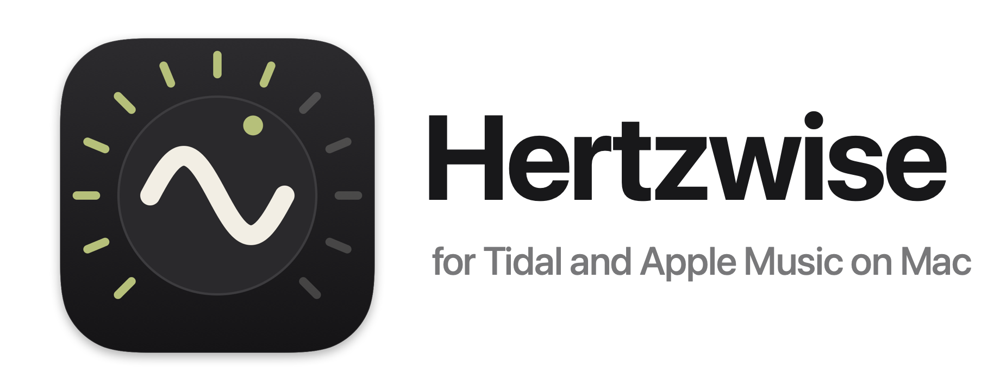
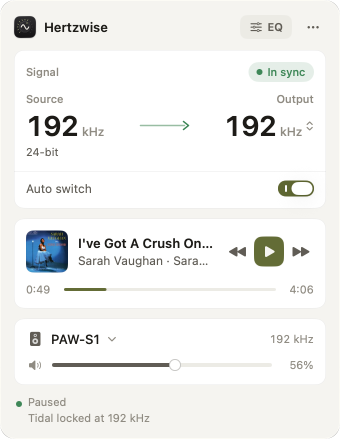

<picture>
  <source media="(prefers-color-scheme: dark)" srcset="branding/banner-dark.png">
  
</picture>

# Hertzwise

Automatic sample-rate switching for Mac music players, so your DAC follows every track and lossless plays bit-perfect.

It works with Apple Music and Tidal, adds a volume stage for DACs that ignore the Mac's volume, and has a headphone EQ you switch on per output device.

<picture>
  <source media="(prefers-color-scheme: dark)" srcset="branding/screenshots/panel-dark.png">
  
</picture>

## Status

| Player | Rate switching | Status |
|---|---|---|
| Apple Music | Yes | From SyncHz |
| Tidal (exclusive mode off) | Yes | New |
| YouTube Music | Planned | Later |

## Per-device volume and EQ

Each output device's submenu has two switches, on by default only for the Lotoo PAW S1:

- **Control volume**: for a DAC that accepts the Mac's volume but ignores it. Hertzwise applies that volume to the samples; at full volume they reach the DAC unchanged.
- **Equalizer**: the headphone EQ processes everything playing to that device, from any app, while the EQ is on.

Both run in one muted process tap per device, so each device is processed once.

## How it works

macOS runs each output device at one sample rate and resamples everything to it. Hertzwise sets that rate to the playing track's own rate.

- **Tidal**: Core Audio logs the decoded track's format from inside Tidal's player to the unified log, in real time. Hertzwise reads it there, and reads Tidal's own `player.log` at start-up. It switches the device Tidal plays to, which can differ from the system output.
- **Apple Music**: Music's messages in the unified log, read through `log stream`, the approach Hertzwise inherits from SyncHz.
- **A rate the DAC can't play**: the DAC plays the nearest rate it supports, and Hertzwise shows a notice instead of claiming the switch.
- **Volume and EQ**: a muted process tap per device, bound to the device's clock, so nothing is resampled. At full volume with the EQ off, samples reach the DAC unchanged. Details: [docs/audio-engine.md](https://github.com/zeetabit/Hertzwise/blob/main/docs/audio-engine.md).

## Install

1. Download the latest `.dmg` from [Releases](https://github.com/zeetabit/Hertzwise/releases/latest) and drag **Hertzwise** into Applications.
2. It is not notarized, so clear the quarantine flag once:
   ```bash
   xattr -dr com.apple.quarantine /Applications/Hertzwise.app
   ```

After that, Hertzwise updates itself: it checks daily and installs a new version from the panel's menu, with no quarantine step and no new permission prompts.

Requires macOS 15 or later. Hertzwise can be installed next to SyncHz: settings, EQ profiles and permissions are separate.

## Build from source

```bash
git clone --recursive https://github.com/zeetabit/Hertzwise.git
cd Hertzwise
open SampleRateSwitcher.xcodeproj
```

Needs Xcode 26 or later. In an existing clone, run `git submodule update --init` once.

How the audio path works, and why: [docs/audio-engine.md](https://github.com/zeetabit/Hertzwise/blob/main/docs/audio-engine.md). Releases, signing and the update keys: [docs/releasing.md](https://github.com/zeetabit/Hertzwise/blob/main/docs/releasing.md).

### Updating the MediaRemote adapter

Track info and playback controls come from [mediaremote-adapter](https://github.com/ungive/mediaremote-adapter), pinned as a submodule in `Vendor/mediaremote-adapter`. Updates are deliberate:

1. Read the release notes of the new tag and the diff since the pinned one:
   ```bash
   cd Vendor/mediaremote-adapter
   git fetch --tags
   git log --oneline HEAD..NEW_TAG
   git diff HEAD NEW_TAG -- src bin include CMakeLists.txt
   ```
2. Check the diff for anything a now-playing reader should not do (network, file writes, spawning processes) and for changes to the `stream` and `send` output the app parses.
3. `git checkout NEW_TAG`, build, run the tests and check track info and playback controls with Tidal and Apple Music.
4. Commit the new pin from the repository root: `git add Vendor/mediaremote-adapter`.

## Acknowledgements

- **[SyncHz](https://github.com/jcongaku/SyncHz)** by Gary Kong, which Hertzwise is built on. Its README explains how rate detection and the EQ filters work.
- **[LosslessSwitcher](https://github.com/vincentneo/LosslessSwitcher)** by Vincent Neo, which SyncHz credits as its inspiration.
- **[mediaremote-adapter](https://github.com/ungive/mediaremote-adapter)** by Jonas van den Berg, BSD 3-Clause, for now-playing access on macOS 15.4 and later.

## License

[MIT](https://github.com/zeetabit/Hertzwise/blob/main/LICENSE). The original copyright notice is kept as the license requires.
